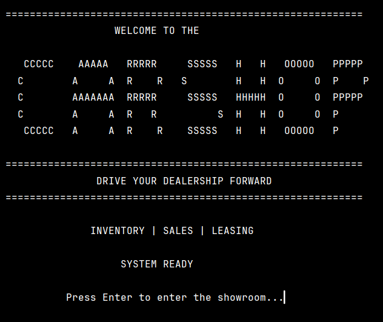
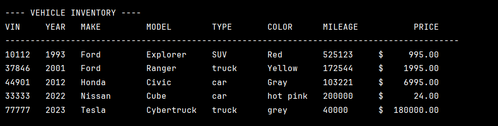

# Car Dealership Application
## Project Overview
The Car Dealership Application is a Java console based program that allows users to manage a dealership's vehicle inventory. Users can search for vehicles using different criteria, view the entire inventory, add new vehicles, and remove existing vehicles.


The Car Dealership Application is a Java console-based program that allows users to manage a dealership's vehicle inventory. Users can search for vehicles using different criteria, view the entire inventory, add new vehicles, and remove existing vehicles.

The application uses object-oriented programming, ArrayLists, file handling, and input validation to manage vehicle information.
## How to Run the Application

1. Clone or download this repository.

2. Open the project in IntelliJ IDEA.

3. Make sure the project is configured to use a compatible Java JDK.

4. Ensure inventory.csv is available in the project's expected location.

5. Open Program.java.

6. Run the main() method.

7. Use the numbered menu options to interact with the dealership.

# Features
### Users can search the dealership inventory using six different options:

1. Search by Price: Find vehicles within a minimum and maximum price.

2. Search by Make and Model: Find vehicles matching a specific manufacturer and model.

3. Search by Year: Find vehicles within a specified year range.

4. Search by Color: Find vehicles matching a selected color.

5. Search by Mileage: Find vehicles within a minimum and maximum mileage range.

6. Search by Vehicle Type: Find vehicles based on their type.

##  View Inventory


### Users can display all vehicles currently available in the dealership inventory.

### Vehicle information is displayed in a formatted table containing:


Users can display all vehicles currently available in the dealership inventory.

Vehicle information is displayed in a formatted table containing:

1. VIN

2. Year

3. Make

4. Model

5. Vehicle Type

6. Color

7. Mileage

8. Price

The application also displays the total number of vehicles returned.

## Add Vehicles

### Users can add new vehicles by entering their information.

### The application validates the information before adding the vehicle to the inventory.

### Validation includes:
1. VIN must be greater than zero.

2. Duplicate VINs are not allowed.

3. Vehicle year must be 1886 or later.

4. Make, model, vehicle type, and color cannot be empty.

5. Mileage cannot be negative.

6. Price cannot be negative.

7. Invalid numeric inputs are rejected.

8. Vehicle text fields cannot contain the | character when using the string input helper.

## Remove Vehicles

Users can remove vehicles by entering their VIN.

The application searches the inventory for a matching vehicle.

If the vehicle exists, it is removed from the dealership inventory, and the updated information is saved to inventory.csv.

If the vehicle cannot be found, the application displays an appropriate message.

## Sales and Leasing

The application allows users to sell or lease vehicles directly from the dealership inventory.
Vehicle Sales

When selling a vehicle, the application:

1. Asks for the vehicle's VIN.

2. Searches the dealership inventory for the vehicle.

3. Collects the customer's name and email address.

4. Asks whether the customer wants to finance the purchase.

5. Creates a SalesContract.

6. Calculates the total purchase price and monthly payment.

7. Displays a contract summary.

8. Saves the contract to contracts.csv.

9. Removes the vehicle from inventory after the contract saves successfully.

### Sales Calculations

Sales contracts include:

- **Sales Tax:** 5% of the vehicle price.
- **Recording Fee:** $100.
- **Processing Fee:** &#36;295  for vehicles under &#36;10,000 or &#36;495 for vehicles costing $10,000 or more.

The total purchase price includes the vehicle price, sales tax, recording fee, and processing fee.

If the customer finances the vehicle, the application calculates monthly payments using the following terms:

| Vehicle Price | Interest Rate | Loan Term |
|---|---|---|
| Under $10,000 | 5.25% | 24 months |
| $10,000 or more | 4.25% | 48 months |

The total purchase price includes the vehicle price, sales tax, recording fee, and processing fee.

If the customer finances the vehicle, the application calculates monthly payments using the following terms:
### Vehicle Leasing

When leasing a vehicle, the application:

1. Searches for the vehicle using its VIN.
2. Collects customer information.
3. Checks whether the vehicle meets the age requirement.
4. Creates a `LeaseContract`.
5. Calculates the lease total and monthly payment.
6. Displays a contract summary.
7. Saves the lease contract to `contracts.csv`.
8. Removes the vehicle from inventory after the contract saves successfully.

### Lease Restrictions

Vehicles more than three years old cannot be leased.

For example, in 2026:

- A 2026 vehicle is eligible.
- A 2024 vehicle is eligible.
- A 2023 vehicle is eligible.
- A 2022 vehicle is not eligible.

If a vehicle is too old, the application displays a message and returns to the main menu without creating a lease.

### Lease Calculations

Lease contracts use the following calculations:

- **Ending Value:** 50% of the vehicle price.
- **Lease Fee:** 7% of the vehicle price.
- **Total Lease Price:** Ending value plus lease fee.
- **Monthly Payment:** Calculated using a 4.0% annual interest rate over 36 months.

## Application Menu

### When the application starts, users are presented with the following menu:

Application Menu

When the application starts, users are presented with the following menu:
```
---- CAR DEALERSHIP ----
1) Find vehicles by price
2) Find vehicles by make/model
3) Find vehicles by year
4) Find vehicles by color
5) Find vehicles by mileage
6) Find vehicles by type
7) List all vehicles
8) Add a vehicle
9) Remove a vehicle
0) Exit
   Enter your choice:
```

## Interesting Code

One interesting part of this project is the reusable input validation methods.

Instead of writing the same validation logic multiple times, I created helper methods to handle different types of user input.
## String Input Validation
```java
private String promptForString(String prompt) {

    while (true) {

        System.out.print(prompt);
        String input = scanner.nextLine().trim();

        if (input.isBlank()) {
            System.out.println("Input cannot be empty.");
        } else if (input.contains("|")) {
            System.out.println("Input cannot contain |.");
        } else {
            return input;
        }
    }
}
```
### Saving Contracts Safely

The application checks whether a contract was saved successfully before removing the vehicle from inventory.

```java
ContractDataManager manager = new ContractDataManager();

boolean saved = manager.saveContract(contract);

if (!saved) {
    System.out.println("Contract could not be saved. Vehicle will remain in inventory.");
    return;
}
```

This prevents the vehicle from being removed when the contract saving operation reports a failure.

It also helped me understand why checking the results of file operations is important.

# Screenshots:
## Welcome Screen


## List All Vehicles 
